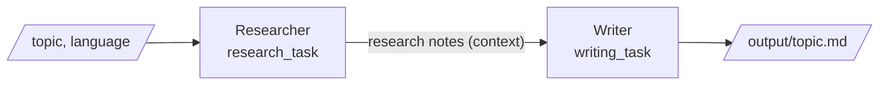

# Phase 1: Researcher + Writer Crew

একটা topic দিলে দুইজন agent মিলে একটা markdown report বানায়। **Researcher** topic নিয়ে তথ্য জোগাড় করে, আর **Writer** সেই notes থেকে report লেখে। Phase 1-এর সব core concept (`Agent`, `Task`, `Crew`, `Process.sequential`, YAML config, inputs) এই একটা project-এই আছে।

## চালানো

আগে [SETUP.md](../SETUP.md) অনুযায়ী environment ready করুন, তারপর repo root থেকে:

```bash
uv run main.py --ping                                   # setup ঠিক আছে কিনা
uv run python -m phase1_research_crew "Java virtual threads"
uv run python -m phase1_research_crew "Kafka vs RabbitMQ" --language Bangla
```

- Report save হয় `output/<topic>.md`-এ, যেমন `output/kafka-vs-rabbitmq.md`। `output/` folder git-ignored।
- চলার সময় terminal-এ প্রতিটা agent-এর কাজ আর final answer দেখাবে (`verbose=True`)। শেষে কত token খরচ হলো সেটাও print করে।
- প্রতি run-এ ২টা LLM call হয় (প্রতি agent-এ একটা)। এর আগে CrewAI token গোনার জন্য free `count_tokens` call-ও করে।
- প্রথমবার চালানোর পর CrewAI একবার জিজ্ঞেস করতে পারে `Would you like to view your execution traces? [y/N]`। `N` দিন, বা ২০ সেকেন্ড অপেক্ষা করলে নিজেই চলে যাবে।

## কীভাবে কাজ করে



1. `kickoff(inputs={"topic": ..., "language": ...})` চালালে YAML-এর `{topic}` আর `{language}` placeholder এই value দিয়ে বদলে যায়।
2. `Process.sequential`: task গুলো যে ক্রমে define করা, সেই ক্রমে একটার পর একটা চলে।
3. `research_task`-এর output CrewAI নিজেই `writing_task`-এর prompt-এ context হিসেবে জুড়ে দেয়। এর জন্য আলাদা code লাগে না।
4. শেষ task-এর output (`result.raw`) `__main__.py` file-এ save করে।

## File গুলো

| File | কী আছে |
|---|---|
| [`config/agents.yaml`](config/agents.yaml) | দুই agent-এর `role`, `goal`, `backstory` |
| [`config/tasks.yaml`](config/tasks.yaml) | দুই task-এর `description`, `expected_output`, আর কোন agent করবে |
| [`crew.py`](crew.py) | `@CrewBase` class, যেটা YAML থেকে `Agent`, `Task` আর `Crew` বানায় |
| [`__main__.py`](__main__.py) | CLI: input নেয়, crew চালায়, report save করে |

## Spring Boot-এর সাথে তুলনা

| CrewAI | Spring Boot |
|---|---|
| `@CrewBase` class | `@Configuration` class |
| `@agent` / `@task` method | `@Bean` method। একবারই চলে আর cache হয়, তাই task আর crew একই `Agent` object পায় (singleton bean-এর মতো) |
| `agents.yaml`, `tasks.yaml` | `application.yml`: config code থেকে আলাদা থাকে |
| `{topic}` placeholder | `${property}` placeholder |
| `crew().kickoff(inputs=...)` | service method call |

## Claude আসলে কী prompt পায়

YAML-এর field গুলো CrewAI এভাবে prompt-এ বসায় (researcher-এর জন্য, সংক্ষেপে):

```text
system: You are Apache Kafka Senior Research Analyst. You are a meticulous research
        analyst. ... Your personal goal is: Gather accurate, well-organized facts ...

user:   Current Task: Research "Apache Kafka". Cover:
        1. What it is and why it matters
        ...
        This is the expected criteria for your final answer: Research notes in markdown ...
        Provide your complete response:
```

অর্থাৎ `role` + `backstory` + `goal` মিলে **system prompt** হয়, আর task-এর `description` + `expected_output` যায় **user message**-এ। Writer-এর user message-এর শেষে `This is the context you're working with:`-এর পরে researcher-এর পুরো notes থাকে।

## Test

```bash
uv run pytest
```

Test গুলো আসল Claude API call করে না। [`tests/conftest.py`](../tests/conftest.py)-র একটা fake Anthropic server Claude-এর জায়গায় উত্তর দেয়, তাই কোনো খরচ হয় না। যা যা check করে:

- crew-এ researcher আগে, writer পরে, আর প্রতিটা task ঠিক agent পেয়েছে
- CLI report file ঠিক নামে save করে
- researcher-এর output writer-এর prompt-এ context হিসেবে পৌঁছায়
- কোনো request-এ `temperature` নেই (নতুন Claude model ওটা পেলে 400 error দেয়)

## Limitation

Researcher-এর internet access নেই, শুধু model-এর নিজের জ্ঞান থেকে লেখে। তাই একদম নতুন তথ্য বাদ পড়তে পারে বা পুরোনো হতে পারে। এজন্য backstory-তে বলা আছে কোনো statistics, version বা link বানিয়ে না লিখতে, আর অনিশ্চিত তথ্য `(unverified)` দিয়ে mark করতে। Phase 2-এ web search tool (`SerperDevTool`) যোগ করে এই সমস্যা কমানো হবে।

## নিজে করে দেখুন

1. `--language Bangla` দিয়ে চালিয়ে English report-এর সাথে তুলনা করুন।
2. `agents.yaml`-এ writer-এর নিচে `llm: anthropic/claude-haiku-5-5` যোগ করুন। Writer তখন সস্তা model দিয়ে লিখবে; quality আর token খরচ তুলনা করুন।
3. তৃতীয় agent **Editor** যোগ করুন, যে report review করে ভুল ঠিক করবে। `agents.yaml`, `tasks.yaml` আর `crew.py`-তে একটা করে নতুন entry লাগবে।
4. `research_task`-এ `output_file: output/research-notes.md` যোগ করুন, তাহলে research notes-ও আলাদা file-এ save হবে।
5. `__main__.py`-তে `result.tasks_output[0].raw` দিয়ে research notes পড়ে print করুন।

## Interview Questions

1. **Agent-এর role, goal আর backstory কোথায় যায়?**
   এগুলো মিলে agent-এর system prompt হয়। Task-এর `description` আর `expected_output` যায় user message-এ।
2. **Sequential process-এ পরের task আগের task-এর output কীভাবে পায়?**
   CrewAI আগের task-এর output পরের task-এর prompt-এ context হিসেবে যোগ করে দেয়। নির্দিষ্ট কোনো task-এর output চাইলে task-এ `context: [task_name]` দিতে হয়।
3. **Prompt YAML-এ কেন, Python code-এ কেন না?**
   Prompt বারবার বদলায়, code কম বদলায়। আলাদা রাখলে code না ছুঁয়েই prompt tune করা যায়, আর review-ও সহজ হয়। Spring-এর externalized configuration-এর মতোই ধারণা।
4. **`expected_output` কেন জরুরি?**
   এটা agent-কে বলে দেয় "কাজ শেষ" দেখতে কেমন: format, length আর scope। এটা ছাড়া output অগোছালো বা অসম্পূর্ণ হয়।
5. **এই crew-তে hallucination-এর ঝুঁকি কোথায়, আর কীভাবে কমাবেন?**
   Researcher internet ছাড়া model-এর memory থেকে লেখে, তাই ঝুঁকি সেখানেই। কমানোর উপায়: prompt-এ তথ্য বানাতে নিষেধ করা আর অনিশ্চিত তথ্য mark করানো, writer-কে notes-এর বাইরে কিছু লিখতে নিষেধ করা, আর Phase 2-এ web search tool দিয়ে তথ্য যাচাই করা।
